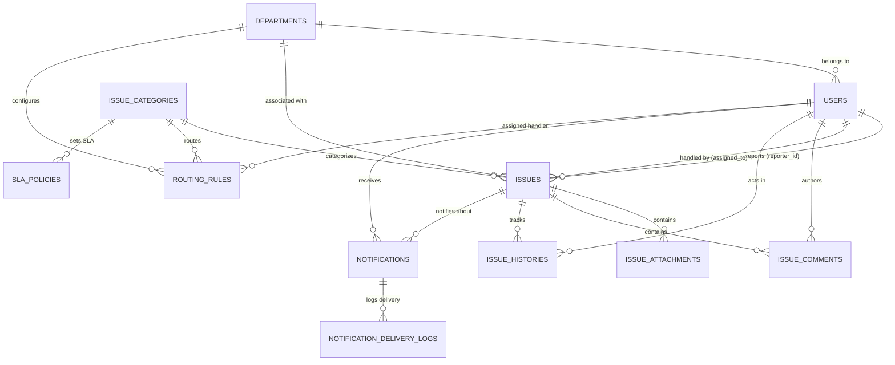

# CampusCare — Database Design & Schema Specification

## 1. Relational Schema Overview

CampusCare utilizes MySQL 8.x / 9.x with InnoDB storage engine. All migrations are tracked and applied sequentially via **Flyway** under `backend/src/main/resources/db/migration/`.

### Entity Relationship Diagram (ERD)



---

## 2. Table Specifications

### 2.1 `departments`
Stores departmental divisions (e.g. Computer Science, Mechanical, Civil, Electrical).
| Column | Type | Constraints | Description |
|---|---|---|---|
| `id` | BIGINT | PRIMARY KEY AUTO_INCREMENT | Internal primary key |
| `name` | VARCHAR(100) | NOT NULL UNIQUE | Department display name |
| `department_code` | VARCHAR(20) | NOT NULL UNIQUE | Short acronym (e.g. `CSE`, `MECH`) |
| `active` | BOOLEAN | NOT NULL DEFAULT TRUE | Soft active status |
| `created_at` | DATETIME | NOT NULL | Record creation timestamp |
| `updated_at` | DATETIME | NOT NULL | Last update timestamp |

### 2.2 `users`
Stores all system accounts across all roles.
| Column | Type | Constraints | Description |
|---|---|---|---|
| `id` | BIGINT | PRIMARY KEY AUTO_INCREMENT | User ID |
| `full_name` | VARCHAR(120) | NOT NULL | Full name of user |
| `email` | VARCHAR(150) | NOT NULL UNIQUE | Institutional email address |
| `password_hash` | VARCHAR(255) | NOT NULL | BCrypt hashed password |
| `role` | VARCHAR(30) | NOT NULL | `ROLE_STUDENT`, `ROLE_FACULTY`, `ROLE_HOD`, `ROLE_ADMIN` |
| `department_id` | BIGINT | NULL, FK(`departments.id`) | Nullable for global Admins |
| `phone_number` | VARCHAR(20) | NULL | Optional contact number |
| `active` | BOOLEAN | NOT NULL DEFAULT TRUE | Account state |
| `created_at` | DATETIME | NOT NULL | Creation timestamp |
| `updated_at` | DATETIME | NOT NULL | Last update timestamp |

*Index*: `idx_users_email` (`email`), `idx_users_role_dept` (`role`, `department_id`).

### 2.3 `issue_categories`
Configurable categorization for reported problems.
| Column | Type | Constraints | Description |
|---|---|---|---|
| `id` | BIGINT | PRIMARY KEY AUTO_INCREMENT | Category ID |
| `code` | VARCHAR(50) | NOT NULL UNIQUE | Enum/code key (`ACADEMIC`, `INFRASTRUCTURE`, etc.) |
| `name` | VARCHAR(100) | NOT NULL | Display title |
| `description` | TEXT | NULL | Context or help description |
| `active` | BOOLEAN | NOT NULL DEFAULT TRUE | Active status |
| `created_at` | DATETIME | NOT NULL | Creation timestamp |
| `updated_at` | DATETIME | NOT NULL | Last update timestamp |

### 2.4 `routing_rules`
Defines dynamic routing from department + category to the responsible handler.
| Column | Type | Constraints | Description |
|---|---|---|---|
| `id` | BIGINT | PRIMARY KEY AUTO_INCREMENT | Rule ID |
| `department_id` | BIGINT | NOT NULL, FK(`departments.id`) | Target department |
| `category_id` | BIGINT | NOT NULL, FK(`issue_categories.id`) | Target issue category |
| `assignee_id` | BIGINT | NOT NULL, FK(`users.id`) | Responsible faculty/staff |
| `priority_condition` | VARCHAR(20) | NULL | Optional priority filter (`ALL`, `HIGH_ONLY`, etc.) |
| `active` | BOOLEAN | NOT NULL DEFAULT TRUE | Rule active state |
| `created_at` | DATETIME | NOT NULL | Timestamp |
| `updated_at` | DATETIME | NOT NULL | Timestamp |

*Constraint*: `uq_dept_cat_priority` UNIQUE (`department_id`, `category_id`, `priority_condition`).

### 2.5 `sla_policies`
Configures expected response and resolution durations.
| Column | Type | Constraints | Description |
|---|---|---|---|
| `id` | BIGINT | PRIMARY KEY AUTO_INCREMENT | Policy ID |
| `category_id` | BIGINT | NOT NULL, FK(`issue_categories.id`) | Category |
| `priority` | VARCHAR(20) | NOT NULL | `LOW`, `MEDIUM`, `HIGH`, `CRITICAL` |
| `response_target_hours` | INT | NOT NULL | Hours to acknowledge |
| `resolution_target_hours`| INT | NOT NULL | Hours to mark resolved |
| `active` | BOOLEAN | NOT NULL DEFAULT TRUE | Active state |
| `created_at` | DATETIME | NOT NULL | Timestamp |
| `updated_at` | DATETIME | NOT NULL | Timestamp |

*Constraint*: `uq_cat_priority` UNIQUE (`category_id`, `priority`).

### 2.6 `issues`
Core aggregate entity tracking issue submissions.
| Column | Type | Constraints | Description |
|---|---|---|---|
| `id` | BIGINT | PRIMARY KEY AUTO_INCREMENT | Internal PK |
| `public_issue_id` | VARCHAR(30) | NOT NULL UNIQUE | User-facing identifier (e.g. `CC-2026-00001`) |
| `title` | VARCHAR(200) | NOT NULL | Brief summary |
| `description` | TEXT | NOT NULL | Comprehensive explanation |
| `category_id` | BIGINT | NOT NULL, FK(`issue_categories.id`) | Categorization |
| `department_id` | BIGINT | NOT NULL, FK(`departments.id`) | College Department |
| `reporter_id` | BIGINT | NOT NULL, FK(`users.id`) | Submitting student |
| `assigned_to` | BIGINT | NULL, FK(`users.id`) | Current handler (NULL if unassigned) |
| `status` | VARCHAR(30) | NOT NULL | `SUBMITTED`, `UNASSIGNED`, `ASSIGNED`, `ACKNOWLEDGED`, `IN_PROGRESS`, `RESOLVED`, `CLOSED`, `REOPENED`, `REJECTED` |
| `priority` | VARCHAR(20) | NOT NULL | `LOW`, `MEDIUM`, `HIGH`, `CRITICAL` |
| `location` | VARCHAR(200) | NOT NULL | Physical venue (e.g., `Lab 3, Block B`) |
| `response_due_at` | DATETIME | NULL | SLA acknowledgment deadline |
| `resolution_due_at` | DATETIME | NULL | SLA resolution deadline |
| `acknowledged_at` | DATETIME | NULL | When handler acknowledged |
| `resolved_at` | DATETIME | NULL | When marked resolved |
| `closed_at` | DATETIME | NULL | When confirmed and closed |
| `resolution_notes` | TEXT | NULL | Handler's resolution description |
| `rejection_reason` | TEXT | NULL | Mandatory reason if rejected |
| `reopen_count` | INT | NOT NULL DEFAULT 0 | Count of reopening events |
| `escalation_level` | INT | NOT NULL DEFAULT 0 | 0=None, 1=Overdue Warning, 2=HOD Escalated |
| `is_overdue` | BOOLEAN | NOT NULL DEFAULT FALSE | True if SLA breached |
| `version` | BIGINT | NOT NULL DEFAULT 0 | Optimistic concurrency control |
| `created_at` | DATETIME | NOT NULL | Timestamp |
| `updated_at` | DATETIME | NOT NULL | Timestamp |

*Indexes*:
- `idx_issues_dept_status` (`department_id`, `status`)
- `idx_issues_reporter` (`reporter_id`, `created_at`)
- `idx_issues_assignee_status` (`assigned_to`, `status`)
- `idx_issues_public_id` (`public_issue_id`)
- `idx_issues_due_at` (`is_overdue`, `resolution_due_at`)

### 2.7 `issue_histories`
Immutable audit trail capturing all lifecycle events.
| Column | Type | Constraints | Description |
|---|---|---|---|
| `id` | BIGINT | PRIMARY KEY AUTO_INCREMENT | History ID |
| `issue_id` | BIGINT | NOT NULL, FK(`issues.id`) | Associated issue |
| `actor_id` | BIGINT | NULL, FK(`users.id`) | User who performed action (NULL for system) |
| `event_type` | VARCHAR(50) | NOT NULL | `CREATED`, `ROUTED`, `ASSIGNED`, `REASSIGNED`, `ACKNOWLEDGED`, `STATUS_CHANGED`, `PRIORITY_CHANGED`, `COMMENTED`, `RESOLVED`, `CLOSED`, `REOPENED`, `REJECTED`, `ESCALATED` |
| `old_status` | VARCHAR(30) | NULL | Status prior to event |
| `new_status` | VARCHAR(30) | NULL | Status after event |
| `previous_assignee_id` | BIGINT | NULL, FK(`users.id`) | Prior handler |
| `new_assignee_id` | BIGINT | NULL, FK(`users.id`) | New handler |
| `comment` | TEXT | NULL | Event context, notes, or rejection reason |
| `created_at` | DATETIME | NOT NULL | Event timestamp |

*Index*: `idx_issue_histories_issue` (`issue_id`, `created_at`).

### 2.8 `issue_comments`
Discussion thread on issues with visibility segregation.
| Column | Type | Constraints | Description |
|---|---|---|---|
| `id` | BIGINT | PRIMARY KEY AUTO_INCREMENT | Comment ID |
| `issue_id` | BIGINT | NOT NULL, FK(`issues.id`) | Associated issue |
| `author_id` | BIGINT | NOT NULL, FK(`users.id`) | Comment creator |
| `body` | TEXT | NOT NULL | Message text |
| `visibility` | VARCHAR(20) | NOT NULL DEFAULT 'STUDENT_VISIBLE' | `STUDENT_VISIBLE` or `INTERNAL_STAFF` |
| `created_at` | DATETIME | NOT NULL | Timestamp |
| `updated_at` | DATETIME | NOT NULL | Timestamp |

*Index*: `idx_issue_comments_issue_vis` (`issue_id`, `visibility`).

### 2.9 `issue_attachments`
Uploaded files associated with an issue (reporting proof or resolution evidence).
| Column | Type | Constraints | Description |
|---|---|---|---|
| `id` | BIGINT | PRIMARY KEY AUTO_INCREMENT | Attachment ID |
| `issue_id` | BIGINT | NOT NULL, FK(`issues.id`) | Associated issue |
| `uploaded_by` | BIGINT | NOT NULL, FK(`users.id`) | Uploader user ID |
| `storage_key` | VARCHAR(255) | NOT NULL UNIQUE | Safe generated disk file path/UUID |
| `original_file_name` | VARCHAR(255) | NOT NULL | Original client filename |
| `content_type` | VARCHAR(100) | NOT NULL | Validated MIME type (`image/jpeg`, etc.) |
| `file_size` | BIGINT | NOT NULL | File size in bytes |
| `attachment_type` | VARCHAR(30) | NOT NULL DEFAULT 'REPORT_ATTACHMENT' | `REPORT_ATTACHMENT` or `RESOLUTION_EVIDENCE` |
| `created_at` | DATETIME | NOT NULL | Timestamp |

### 2.10 `notifications`
In-app notification records for users.
| Column | Type | Constraints | Description |
|---|---|---|---|
| `id` | BIGINT | PRIMARY KEY AUTO_INCREMENT | Notification ID |
| `recipient_id` | BIGINT | NOT NULL, FK(`users.id`) | Target user |
| `issue_id` | BIGINT | NULL, FK(`issues.id`) | Associated issue |
| `notification_type` | VARCHAR(50) | NOT NULL | `ISSUE_ASSIGNED`, `STATUS_CHANGED`, `SLA_BREACH`, `COMMENT_ADDED`, etc. |
| `title` | VARCHAR(150) | NOT NULL | Short title |
| `message` | TEXT | NOT NULL | Notification body |
| `is_read` | BOOLEAN | NOT NULL DEFAULT FALSE | Unread state |
| `read_at` | DATETIME | NULL | Timestamp read |
| `created_at` | DATETIME | NOT NULL | Timestamp created |

*Index*: `idx_notif_recipient_read` (`recipient_id`, `is_read`, `created_at`).

### 2.11 `notification_delivery_logs`
Delivery status and retry tracking for outbound channels (e.g. email).
| Column | Type | Constraints | Description |
|---|---|---|---|
| `id` | BIGINT | PRIMARY KEY AUTO_INCREMENT | Log ID |
| `notification_id` | BIGINT | NOT NULL, FK(`notifications.id`) | Target notification |
| `channel` | VARCHAR(20) | NOT NULL | `EMAIL`, `SMS`, `IN_APP` |
| `delivery_status` | VARCHAR(20) | NOT NULL | `PENDING`, `SENT`, `FAILED`, `SKIPPED` |
| `attempts` | INT | NOT NULL DEFAULT 1 | Attempt count |
| `last_error` | TEXT | NULL | Exception message on failure |
| `last_attempt_at` | DATETIME | NOT NULL | Attempt timestamp |
| `created_at` | DATETIME | NOT NULL | Creation timestamp |

---

## 3. Atomic Issue ID Generation Strategy

To produce deterministic, human-readable IDs formatted as `CC-{YEAR}-{00001}` without table-lock contention:
1. An auxiliary sequence table `issue_sequences (year INT PRIMARY KEY, current_val BIGINT NOT NULL)` is maintained.
2. In an atomic transaction:
   ```sql
   INSERT INTO issue_sequences (year, current_val) VALUES (:year, 1)
   ON DUPLICATE KEY UPDATE current_val = current_val + 1;
   SELECT current_val FROM issue_sequences WHERE year = :year;
   ```
3. Formatted as `String.format("CC-%d-%05d", year, sequenceVal)`.
4. Zero risk of duplicate key exceptions or race conditions even under concurrent issue submissions.
