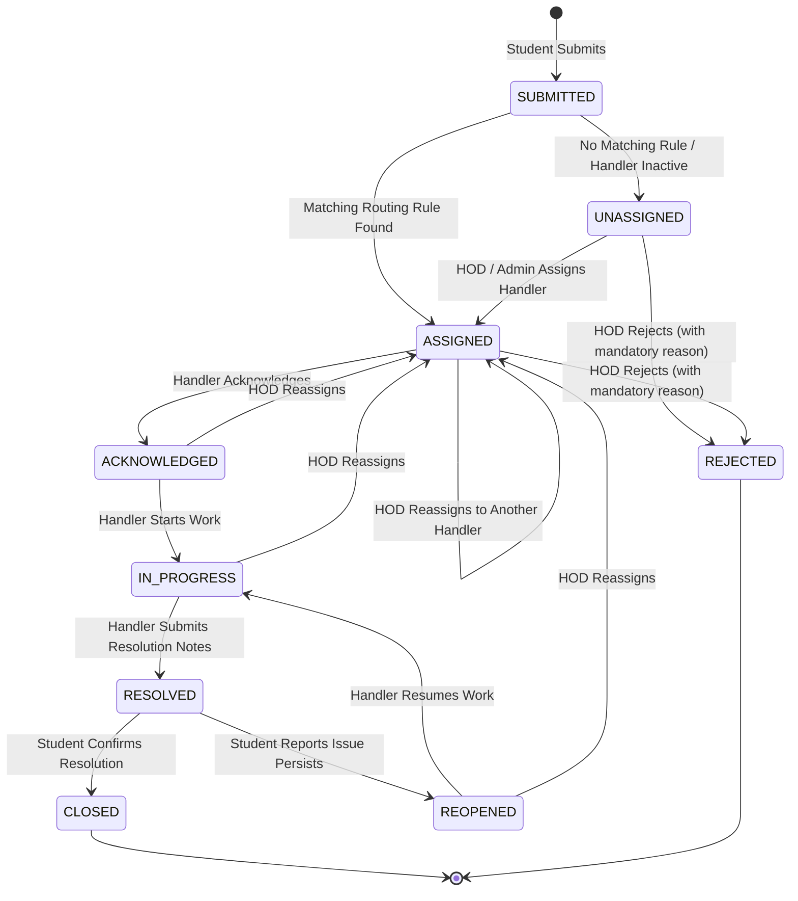

# CampusCare — Issue Lifecycle, State Machine & Workflow Specification

## 1. Lifecycle Status Values

The system implements nine unambiguous status states:

1. `SUBMITTED`: Issue submitted by student; routing engine evaluates category rules.
2. `UNASSIGNED`: Valid issue without an active category routing rule; placed in the departmental unassigned queue.
3. `ASSIGNED`: Routed to a designated handler; awaiting initial acknowledgment.
4. `ACKNOWLEDGED`: Handler has reviewed the issue and acknowledged responsibility.
5. `IN_PROGRESS`: Active investigation or physical/technical remediation is underway.
6. `RESOLVED`: Handler has completed remediation and submitted resolution notes and optional proof.
7. `CLOSED`: Student has confirmed the resolution is satisfactory, or closed via policy.
8. `REOPENED`: Student rejected the resolution because the issue persists; returned to active queue.
9. `REJECTED`: Declared invalid, duplicate, or out of scope by HOD/Admin with mandatory documented reason.

---

## 2. State Transition State Machine

---

## 3. Transition Rules & Precondition Matrix

| From Status | To Status | Allowed Actor(s) | Preconditions & Requirements | Side Effects & Audit Events |
|---|---|---|---|---|
| *(New)* | `SUBMITTED` | Student | Valid title, description, category, location, valid department. | Generate `CC-YYYY-XXXXX`, calculate SLA deadlines, trigger routing. |
| `SUBMITTED` | `ASSIGNED` | System / Auto-Router | Active `RoutingRule` found for department + category. Handler active. | Audit `ROUTED`, set `assigned_to`, create in-app notification for handler. |
| `SUBMITTED` | `UNASSIGNED` | System / Auto-Router | No active `RoutingRule` exists for category in department. | Audit `ROUTED` (Unassigned), alert HOD of unassigned issue. |
| `UNASSIGNED` | `ASSIGNED` | HOD, Admin | Target handler must belong to department and be active. | Audit `ASSIGNED`, set `assigned_to`, notify assigned handler. |
| `UNASSIGNED` | `REJECTED` | HOD, Admin | Mandatory non-empty rejection reason text. | Audit `REJECTED`, record reason, notify student. |
| `ASSIGNED` | `ACKNOWLEDGED` | Assigned Handler | Caller must be the assigned handler. | Record `acknowledged_at`, audit `ACKNOWLEDGED`, notify student. |
| `ASSIGNED` | `ASSIGNED` | HOD, Admin | Target handler is different from current. Mandatory reason. | Audit `REASSIGNED`, notify both previous and new handler. |
| `ASSIGNED` | `REJECTED` | HOD, Admin | Mandatory non-empty rejection reason text. | Audit `REJECTED`, record reason, notify student. |
| `ACKNOWLEDGED` | `IN_PROGRESS` | Assigned Handler | Caller must be the assigned handler. | Audit `STATUS_CHANGED`, notify student that remediation has begun. |
| `IN_PROGRESS` | `RESOLVED` | Assigned Handler | Mandatory `resolutionNotes` (min 10 chars), optional evidence files. | Record `resolved_at`, audit `RESOLVED`, notify student to verify. |
| `RESOLVED` | `CLOSED` | Student (Reporter) | Caller must be the reporter. Optional rating / feedback comments. | Record `closed_at`, audit `CLOSED`, notify handler and HOD. |
| `RESOLVED` | `REOPENED` | Student (Reporter) | Mandatory reopening reason. Increment `reopen_count`. | Audit `REOPENED`, alert handler & HOD of recurring issue. |
| `REOPENED` | `IN_PROGRESS` | Assigned Handler | Handler restarts investigation. | Audit `STATUS_CHANGED`, notify student. |

---

## 4. SLA Target Calculation & Escalation Rules

### 4.1 SLA Defaults (Configurable per Category & Priority)
| Priority | Default Response Target | Default Resolution Target |
|---|---|---|
| `CRITICAL` | 2 Hours | 8 Hours |
| `HIGH` | 4 Hours | 24 Hours |
| `MEDIUM` | 12 Hours | 48 Hours |
| `LOW` | 24 Hours | 96 Hours |

### 4.2 Automated Overdue Detection & Escalation Engine
A scheduled Spring task (`@Scheduled(cron = "0 */15 * * * *")` - runs every 15 minutes):
1. **Response Overdue Check**:
   - Condition: Status is `ASSIGNED` and `response_due_at < NOW()` and `escalation_level = 0`.
   - Action: Set `is_overdue = true`, `escalation_level = 1`.
   - Notification: Send overdue alert to assigned handler.
2. **Resolution Overdue Check**:
   - Condition: Status in (`ASSIGNED`, `ACKNOWLEDGED`, `IN_PROGRESS`, `REOPENED`) and `resolution_due_at < NOW()`.
   - Action: Set `is_overdue = true`.
   - If overdue by > 50% of SLA duration or priority is `CRITICAL`, increment `escalation_level = 2`.
   - Notification: Dispatch **HOD Escalation Alert** to HOD dashboard and notify handler.
   - Audit event: Log `ESCALATED` in `issue_histories`.
3. **Idempotency Guarantee**:
   - Updates track `escalation_level` to prevent duplicate escalation notifications on subsequent cron triggers.
